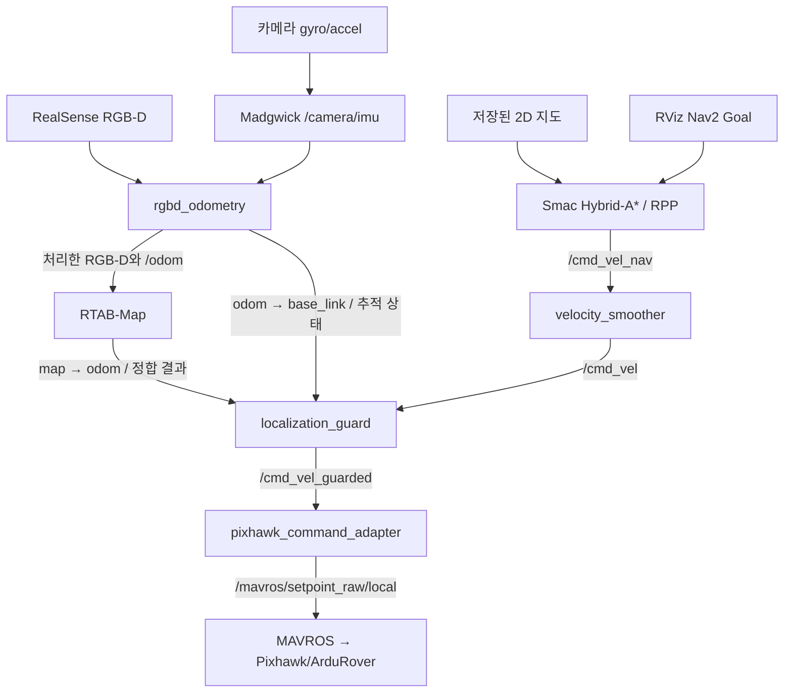

# 시스템 구조

## 지도 기반 주행

| TF | 유일한 발행 주체 |
|---|---|
| `map → odom` | RTAB-Map |
| `odom → base_link` | `rgbd_odometry` |
| `base_link → camera_link` | 외부 static TF 또는 navigation launch 중 하나 |
| 카메라 내부 TF | RealSense 드라이버 |

카메라 IMU는 Madgwick에서 자력계 없이 처리하며 TF를 발행하지 않는다.
MAVROS의 위치/방향은 지도 TF를 대체하지 않는다. 다만 **FCU 내부 속도·방향 추정은 GPS/나침반을
사용하므로**, 카메라 지도가 정상이어도 GPS/나침반 오류가 차량 제어를 망가뜨릴 수 있다.
카메라 오도메트리를 FCU ExternalNav로 공급하는 구조는 아직 아니다.

## 센서와 지도 수명주기

`camera.launch.py`는 RGB 1280×720@15, depth 848×480@15와 카메라 IMU를 사용한다.
VO 연산만 2배 축소하고, DB에 저장할 RGB-D는 유지한다. RTAB에는 VO가 실제 처리한
`/rtabmap/odom_rgbd_image`와 대응하는 `/odom`을 공급하여 지연된 odometry와 최신 이미지를
다시 맞추는 문제를 피한다. 기본 통신은 Jetson 내부 Cyclone DDS이며 원격 ROS 통신은 별도 설정이 필요하다.

`mapping.launch.py`는 새 폴더에 `localization.yaml`을 고정한다. 이어 촬영은 같은 설정과 DB를 사용하고
기존 지도와 정합된 후 새 구간을 연결한다. DB와 내보낸 2D 지도를 함께 보관한다.
지도별 `localization.yaml`/`nav2.yaml`이 있으면 공통 설정보다 우선한다.

`navigation.launch.py`의 실행 모드:

| 모드 | 동작 |
|---|---|
| `planner` (기본값) | 지도와 경로 계획만 실행 |
| `validation` | 위치추정·Nav2·보호 노드, 차량 어댑터 없음 |
| `drive` | validation 구성에 차량 명령 어댑터 추가 |

주행은 원본 지도 대신 `~/ros2_ws/.cache/localization`의 DB 사본을 재사용한다.
원본 식별 정보와 설정이 달라지면 새 사본을 준비하고, 동시 쓰기는 파일 잠금으로 막는다.
정상 종료 시 저장한 전체 작업 메모리/특징점 인덱스는 다음 시작에 재사용한다.
캐시는 원본 지도가 아니며 삭제 후 재생성할 수 있지만 첫 실행 복사·로딩 시간이 늘어난다.

## 주행과 정지

ROS 명령 목표는 직선 0.35m/s, 곡률에 따른 커브 0.25~0.35m/s, 최종 상한 0.4m/s다.
최소 회전반경 1.7m와 동일 footprint를 planner·경로 검증·어댑터에 적용한다.
FCU 실제 차속은 별도 관측 대상이며 ROS 명령 상한이 실제 과속을 물리적으로 막는 것은 아니다.

보호 노드는 native RTAB 정합 증거, VO 추적 상태, odometry/TF, Nav2 활성 상태와 경로·명령의 유효성을
확인한다. RViz의 2D Pose Estimate로 TF가 이동한 것만으로 정합 성공으로 인정하지 않는다.
일반 지도 주행에서는 native 정합을 확인한 후 살아 있는 VO/TF를 추적하며 정지 상태에서
매 프레임 새로운 장소 인식을 요구하지 않는다.

- VO 추적 손실과 구조적 오류 등은 속도 0·HOLD 요청·목표 취소 및 정지 래치를 유발할 수 있다.
- 일시적 준비 상태 상실은 BT `LocalizationReady`가 경로/제어 하위 작업을 중단하고 정지 상태로 대기한다.
- 정지 래치는 건강한 입력만으로 자동 해제되지 않는다. 운영자가 정지/복구를 확인하고 acknowledge한다.
- 어댑터의 입력 timeout은 0.5초다. NaN/Inf 등 잘못된 명령은 즉시 무효화한다.
- 정지/HOLD는 **요청**이다. 실제 모터 정지 여부와 물리적 정지 수단은 별도로 확인한다.

현재 BT에는 제자리 회전·후진 복구가 없고 costmap에는 실시간 장애물 입력이 없다.
따라서 이동 장애물 회피가 가능한 구조라고 해석해서는 안 된다.

## 기존 GPS 경로와 운영 기록

`gps_navigation.launch.py`는 기존 GPS 기반 경로를 위한 별도 실행점이다.
지도 주행의 선택적 `destination`/`route_policy:=graph`는 GPS 경로 그래프를 검토된 ENU→map 변환으로
투영해 Nav2의 최종 목적지와 주행 영역으로 변환한다. GPS-only와 RTAB launch를 동시에 실행하지 않는다.

`tools/ros_session.sh`는 각 프로세스를 독립 tmux 세션에서 유지한다. SSH/VNC 연결이 끊겨도 계속 실행되지만
재부팅·전원 상실을 복구하지는 않는다. 실행 설정과 최대 약 20MiB의 회전식 주행 추적은
`~/ros2_ws/log/navigation`에 저장한다. 영상/rosbag 녹화는 기본 비활성화다.
