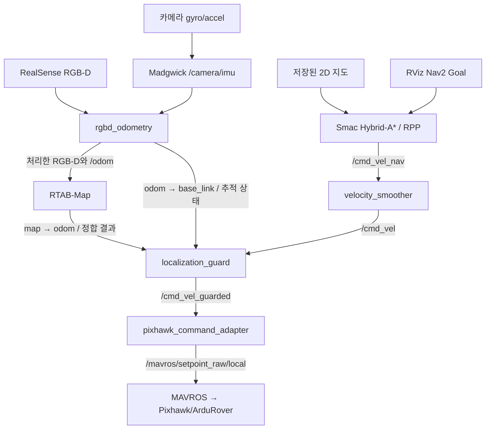

# 시스템 구조

## 웹 임무 계층

`campus_mission`은 기존 navigation 위에 별도로 실행하는 React/FastAPI 임무 계층이다.
LLM은 등록된 장소와 이동·촬영·관찰 임무를 제안하고 Mission Manager가 검증해 Nav2 Action을 실행한다.
도착 후 새 카메라 사진을 VLM에 전달하고 근거·판단 한계를 웹에 표시한다.
장소 좌표는 지도별 `places.yaml`에 묶으며 다른 지도로 자동 승계하지 않는다.
ROS 연결은 별도 프로세스이고 웹은 속도/PWM을 직접 제어하지 않는다.
부팅 시 웹과 외부 HTTPS 연결을 실행하고, 사용자가 주행 준비 버튼을 누르면 센서·지도 준비 후
MAVROS 서비스로 GUIDED/시동을 요청한다. FCU의 시동 검사를 우회하지 않는다.
기존 BT를 유지하고 촬영 임무에만 별도 도착 판정을 선택한다.
실행·지도 교체·검증 범위는 [웹 임무 안내](campus_missions.md)를 참고한다.

## 지도 기반 주행

아래 도식은 기존 카메라 전용 경로다. 카메라+라이다 지도에서는
[융합·회피 구성](sensor_fusion.md)을 사용하며, `odom → base_link` 소유자는
`fusion_inputs`, 차량 명령 경로에는 Collision Monitor가 추가된다.

| TF | 유일한 발행 주체 |
|---|---|
| `map → odom` | RTAB-Map |
| `odom → base_link` | `rgbd_odometry` |
| `base_link → camera_link` | 별도 `camera.launch.py` (주행에 카메라를 포함하면 navigation 소유) |
| 카메라 내부 TF | RealSense 드라이버 |

카메라 IMU는 Madgwick에서 자력계 없이 처리하며 TF를 발행하지 않는다.
매핑·이어 촬영·주행은 `start_mavros:=true start_camera:=true start_lidar:=true`로
센서를 포함해 한 런치에서 실행할 수 있다. 문서는 이 통합 명령을 기본 예시로 사용한다.
세 옵션의 코드 기본값은 false라서 기존 별도 센서 실행 흐름도 유지한다.
이미 별도 실행 중인 센서의 start 옵션은 빼야 한다(자동 중복 탐지 기능은 아니다).
navigation의 `start_camera_tf` 기본값은 `start_camera`를 따른다. 별도 카메라 실행 시 TF가 중복되지 않고,
명시적으로 `start_camera:=true`를 주면 포함된 카메라의 TF는 끄고 navigation이 한 번 발행한다.
외부 카메라를 쓰면서 별도 TF만 필요한 경우 기존 `start_camera_tf:=true` 재정의도 가능하다.
라이다는 `start_lidar:=true`일 때만 `lidar.launch.py`를 포함하며, 포트·방향은
`lidar_port`·`lidar_yaw`로 전달한다. 매핑의 통합 카메라는 새로 고정한 또는 기존
`localization.yaml`을 사용한다. 통합 런치 종료 시 포함된 센서도 함께 종료된다.
센서 시작 옵션은 지도 센서 구성이나 융합·회피 모드를 바꾸지 않는다.
MAVROS의 위치/방향은 지도 TF를 대체하지 않는다. 다만 **FCU 내부 속도·방향 추정은 GPS/나침반을
사용하는 기본 구성에서는**, 카메라 지도가 정상이어도 GPS/나침반 오류가 차량 제어를 망가뜨릴 수 있다.
선택 가능한 `fcu_estimation:=externalnav`는 `/odom`을 FCU의 위치·속도·yaw 입력으로 공급한다.
2026-10-22 실기 FCU 설정 유지와 정지 EKF 융합을 확인했고 launch 기본값도
`fcu_estimation:=externalnav`로 전환했다. validation은 추정값만 전송하고 차량 어댑터는
실행하지 않는다. 실제 이동 중 검증은 남아 있다. GPS 복귀는 FCU 원복 후 명시적으로 선택한다.
[ExternalNav 적용 절차](external_navigation.md)에 설정, 좌표계, 실패 처리와 복원 방법을 정리했다.

## 센서와 지도 수명주기

Nav2는 Smac Hybrid-A*와 RPP를 유지한다. `apply_obstacle_clearance()`가 기존 지도별
설정에도 차량 외곽 padding 0.20m(요청 간격 0.15m + 격자 여유 0.05m)를 적용한다.
라이다 모드의 `/navigation/static_clearance_map`은 추가 팽창 없이 원본 점유 상태를
전달한다(`extra_margin_m=0`). 저장 지도 팽창과 footprint 여유가 중복되지 않는다.
이 구분은 정적/동적 물체 분류가 아니라 저장 지도/실시간 관측의 구분이다.
실시간 스캔에는 사람뿐 아니라 동상·벽·큰 박스도 포함되며, 관측된 점유 영역의
크기에 맞춰 우회한다. 측정면 높이 약 25cm에서 보이는 단면만 반영하므로 낮은
돌출부·측정면 위의 돌출부·가려진 뒷면은 알 수 없다. 큰 물체가 길을 막으면
관측과 재계획으로 우회 경로를 갱신하지만, 회전반경과 여유 폭을 만족하는 길이
없으면 멈춰 기다린다. 실차 충돌 방지를 보장하는 체적 모델은 아니다.
지도 원본 파일·DB·RViz `/map`은 바꾸지 않으며 uint8/int8 지도 연산으로 갱신 시에만 처리한다.
inflation 반경 최소 1.5m, Smac `cost_penalty` 최소 3.0은 유지한다.
전역·지역 코스트맵 및 기존 경로 검사에 동일한 padding을 사용한다. inflation 비용은
여유 있는 경로를 선호하게 하고, 확장 footprint는 근접 경로를 충돌로 판정한다.
이는 저장된 장애물·추정 위치 기준이며 실제 위치추정/조향 오차에 대한 보장은 아니다.
차폭 0.27m 기준 실시간 장애물 사이 직선 통로는 격자화를 제외해도 약 0.67m 이상의 폭이
필요하다. 저장된 장애물에도 같은 기준을 적용한다.
임시 실외 시험 정책으로 전역 obstacle layer의 `footprint_clearing_enabled`를 켠다.
차량 외곽+20cm 안의 과거 라이다 셀이 시작 위치를 막는 문제를 해소하기 위한 것으로,
이 영역의 실시간 점도 전역 obstacle layer에서는 제거될 수 있다. 지역 obstacle layer는
이 옵션을 끈 채 가까운 관측을 유지하며, Collision Monitor도 계속 검사한다.
StaticLayer의 저장 장애물에는 적용하지 않는다. 유효 라이다 광선의 clearing은 유지한다.
라이다 모드 Smac `allow_unknown=true`로 지도 내부 미관측 셀의 탐색을 허용한다.
알려진 장애물과 지도 바깥까지 통행 가능하게 바꾸는 설정은 아니며,
미관측 영역의 지면 상태·낮은 장애물이 안전하다고 보장하지 않는다.
실시간 라이다 Collision Monitor의 `time_before_collision`은 별도로 4.0초다.
현재 실현 가능한 속도·각속도 명령을 유지했을 때 확장 footprint와 관측 장애물이
겹치는지 예측한다. 직진은 직선, 회전은 곡선 궤적으로 검사하며, 4초는 예측 시간이지
고정된 전방 거리 구역이 아니다. 충돌이 예상되지 않으면 이 approach 감속은 개입하지 않는다.
코스트맵 inflation 비용과 RPP의 비용 기반 감속은 별개이므로 궤적 밖 가까운 장애물도
경로 선호·속도에 영향을 줄 수 있다. 보행자의 이동 속도·진행 방향을 예측하지는 않는다.
라이다 모드는 전역 코스트맵을 5Hz로 갱신하며 Smac 탐색과 지역 충돌 검사 모두
원래 지도 해상도(현재 5cm)를 사용한다. Humble의 최대 비용 축소는 unknown=255와
occupied=254가 섞인 셀을 unknown으로 만들 수 있어, 미관측 영역 통행을 허용하는
현재 설정에서는 사용하지 않는다. 매번 최신 장애물 비용으로 탐색하며
동적 장애물용 heuristic cache는 사용하지 않는다. 주행 중에는 목표 2Hz 주기의 Smac 재계획과 RPP 추종을 병행하고, Collision Monitor는
그 사이의 접근 위험에 속도를 연속적으로 제한한다. 통과 가능한 공간이 있으면
감속하면서 우회하며, 장애물 제거가 관측되면 속도를 회복한다.
재계획 결과는 별도 candidate_path에 받고 성공한 결과만 추종 경로에 반영한다.
재계획 실패 시에도 같은 목적지(방향 포함)의 기존 경로가 현재 전역 코스트맵의
IsPathValid footprint 검사를 통과하면 추종을 유지한다. 새 목적지에 이전 경로를
재사용하지 않으며, 유효 경로가 없거나 추종 실패 시 3초 대기 후 다시 계획한다.
라이다 모드는 Humble RPP를 상속한 `ackermann_rpp::Controller`를 사용한다.
곡률을 1/1.7m 이내로 제한한 다음 비용 감속·충돌 예측·속도 출력을 수행하므로,
추종기와 최종 어댑터가 서로 다른 회전 궤적을 검사하지 않는다. 제자리 회전과
충돌 검사 해제는 이 플러그인에서 허용하지 않는다. lookahead는 카메라 주행과 같은
1.0~2.5m로 복원한다. 계획 반경 2.0m와 추종 보정 반경 1.7m는 별개다.
기존 경로가 유효할 때 새 경로는 남은 경로 비용 기준 1 이상 및 10% 이상 개선되어야 교체한다.
전진 구간은 거리 그대로, 후진 구간은 거리의 3배, 전후진 전환은 회당 1을 더한다.
전진만 있는 경로의 기존 비교 기준은 유지한다.
가까운 3m 구간에서 좌우 우회 방향까지 바뀌면 2m 이상 및 20% 이상 개선을 요구한다.
기존 경로를 유지할 때도 새 계획의 시작점에 가장 가까운 노드 앞의 지나온 구간은
제거한다. 남은 경로 형상은 유지하며, 정지 후 FollowPath 재시작 시 출발점부터
다시 검색해 지역 경로가 비어 버리는 문제를 방지한다.
차량이 기존 경로에서 0.6m 넘게 떨어졌거나 경로가 막혔거나 Goal이 바뀌면 즉시 새
경로를 채택할 수 있다. 새 관측이 기존 경로를 막으면 먼저 FollowPath를 취소해
정지시키고 3초 대기 후 우회를 시도한다. 장애물이 사라지면 기존 경로도 다시 사용할
수 있다. 이는 사람 분류가 아니라 기존 경로의 점유 변화에 반응하는 정책이다.
장애물 발견 자체로 HOLD 전환을
요청하지 않는다. 통로가 막히거나 충돌이 임박하면 정지는 여전히 필요하다.
실제 재계획 주기는 탐색 시간에 제한되며 2Hz 달성을 보장하지 않는다.

라이다 모드는 Smac `REEDS_SHEPP`와 RPP `allow_reversing=true`를 함께 사용한다.
전진을 우선하고(`reverse_penalty=3`) 필요한 경우 계획된 후진 구간을 포함한다.
`change_penalty`는 전후진 기어 전환 전용 옵션이 아니므로 기존 0을 유지한다.
거리 heuristic 캐시는 10m 범위로 줄여 Reeds-Shepp 초기화 비용을 제한한다.
이는 지도·경로 탐색 거리의 상한이 아니다. 카메라 단독 모드는 기존 전진 전용을 유지한다.
후진에도 전진과 같은 직선 0.35m/s, 곡률 감속 약 0.25~0.35m/s 및 최종 0.4m/s
상한을 적용한다. 목표 근접·장애물 비용·Collision Monitor에 따라 더 낮아질 수 있다.
전후진 전환은 속도 추정이 0.03m/s 이내로 0.3초 유지된 뒤 허용한다.
겹치는 경로에서 아직 수행하지 않은 전후진 구간을 건너뛰지 않도록 현재 방향 구간
안에서 최근접점을 찾는다. 이전 경로가 뒤에 남았다는 이유로 후진하지 않으며,
현재 위치와 0.75m 넘게 끊긴 경로는 재계획을 요구한다.
후진은 지역 코스트맵의 채워진 차량 footprint와 예상 후진 궤적(최소 0.5m)을 검사한다.
점유·미관측 셀 및 맵 밖으로 후진하지 않는다. 전진의 미관측 영역 허용 정책은 그대로다.
계획기가 후진 미관측 영역을 포함한 경로를 만들더라도 추종기는 이를 실행하지 않으므로,
후방 지도 부족 시 다른 경로나 재매핑이 필요할 수 있다.
전방 200도 라이다로 새 후방 동적 장애물을 확인할 수 없으며 후진 충돌 방지를 보장하지 않는다.
차폭·회전반경·여유 폭을 만족하는 공간이 없는 막다른 곳은 전후진으로도 탈출할 수 없다.
펌웨어·ESC 설정은 변경하지 않았다. 명령 전달은 ArduRover 4.7.1의 BODY_NED 음수 vx와
yaw-rate 조합을 사용하고, MAVROS의 좌표 변환 외에 yaw 부호를 추가로 뒤집지 않는다.
근거: [Nav2 RPP](https://api.nav2.org/nav2-humble/html/regulated__pure__pursuit__controller_8cpp_source.html),
[Smac Hybrid](https://api.nav2.org/nav2-humble/html/smac__planner__hybrid_8cpp_source.html),
[ArduRover 4.7.1 명령 처리](https://github.com/ArduPilot/ardupilot/blob/Rover-4.7.1/Rover/GCS_MAVLink_Rover.cpp).
Collision Monitor 앞에서 최종 어댑터와 같은 속도·최소 회전반경(1.7m)을 적용해
실행 불가능한 급회전 대신 실제 명령 궤적을 검사한다. 라이다 신선도 검사는
`require_scan`을 최종 어댑터에 전달해 활성화한다.
전방 시야 밖으로 사라진 물체는 빈 공간을 다시 관측하기 전까지 남을 수 있으며,
`observation_persistence=0`은 점유 셀의 자동 만료 시간이 아니다.
이것은 사람의 궤적을 예측하는 사회적 내비게이션이 아니므로, 군중 속에서 멈춤 없는
주행을 보장하지 않는다. 현재 Humble RPP는 경로 추종기이며 우회는 재계획이 담당한다.
근거: [Humble RPP 공식 설명](https://api.nav2.org/nav2-humble/html/md_nav2_regulated_pure_pursuit_controller_README.html),
[Collision Monitor 공식 설명](https://api.nav2.org/nav2-humble/html/md_nav2_collision_monitor_README.html).
근거: [Nav2 Humble Smac](https://api.nav2.org/nav2-humble/html/md_nav2_smac_planner_README.html),
[Nav2 경로 비용 튜닝](https://docs.nav2.org/rolling/configuration_and_development/tuning_guide/).

`camera.launch.py`는 RGB 1280×720@15, depth 848×480@15와 카메라 IMU를 사용한다.
VO 연산만 2배 축소하고, DB에 저장할 RGB-D는 유지한다. RTAB에는 VO가 실제 처리한
`/rtabmap/odom_rgbd_image`와 대응하는 `/odom`을 공급하여 지연된 odometry와 최신 이미지를
다시 맞추는 문제를 피한다. 기본 통신은 Jetson 내부 Cyclone DDS이며 원격 ROS 통신은 별도 설정이 필요하다.

`mapping.launch.py`는 새 폴더에 `localization.yaml`을 고정한다. 이어 촬영은 같은 설정과 DB를 사용하고
기존 지도와 정합된 후 새 구간을 연결한다. DB와 내보낸 2D 지도를 함께 보관한다.
지도별 `localization.yaml`/`nav2.yaml`이 있으면 공통 설정보다 우선한다.

`navigation.launch.py`의 실행 모드:

| 모드 | 동작 |
|---|---|
| `planner` (기본값) | 지도와 경로 계획만 실행 |
| `validation` | 위치추정·Nav2·보호 노드, 차량 어댑터 없음 |
| `drive` | validation 구성에 차량 명령 어댑터 추가 |

주행은 원본 지도 대신 `~/ros2_ws/.cache/localization`의 DB 사본을 재사용한다.
원본 식별 정보와 설정이 달라지면 새 사본을 준비하고, 동시 쓰기는 파일 잠금으로 막는다.
같은 사본을 다음 시작에도 재사용하며 매번 수 GB를 복사하지 않는다.
캐시는 원본 지도가 아니며 삭제 후 재생성할 수 있지만 첫 실행 복사·로딩 시간이 늘어난다.

고정 출발점은 지도 폴더의 `startup_pose.yaml`에 `map -> base_link`의
`x y z roll pitch yaw`로 저장한다. `navigation.launch.py`는 localization 시작 시
RTAB의 `initial_pose`로 한 번 전달한다. 원본 DB 경로·크기·수정시각과 지도 YAML 식별값이
달라지면 오래된 힌트를 무시한다. 힌트는 DB 캐시 키를 변경하거나 원본 DB를 수정하지 않는다.
`use_startup_pose:=false`로 끌 수 있고 RViz `/initialpose` 입력도 유지한다.
초기 TF 위치는 정합 성공 증거가 아니며, 기존 native RTAB 정합 확인 후에만 준비 상태가 된다.
힌트 자체는 DB 로딩을 단축하지 않는다. 아래 작업 메모리 정책과 별개다.

## 큰 지도와 Jetson 메모리

운영 기본값은 `localization_memory:=full`이다. `Mem/LoadVisualLocalFeaturesOnInit=false`로
지역 특징점 로딩을 지연하고 `Kp/ByteToFloat=false`로 특징점 비교 정확도를 유지한다.
원본 DB는 보존하며 지도별 localization 사본·인덱스를 재사용한다. 시작할 때마다 수 GB DB를
새로 복사하는 방식이 아니다. 초기 pose 힌트와 DB 캐시는 지도 식별 정보가 맞을 때만 사용한다.

`config/localization_memory.yaml`의 지역 메모리 정책은 **실험용 선택 기능**이다.
`localization_memory:=auto`는 출발점 주변 15m/최대 400노드로 시작하고 작업 노드 600개를 목표로
불러오기·내보내기를 수행한다. 원본 DB의 영상·특징점·노드를 삭제하지 않는다.
완전한 전역 최적화 좌표가 없으면 시작 단계에서 전체 모드로 돌아간다.
지역 모드는 RTAB 0.23 DB 형식을 사용하며 현재 로딩한 노드 밖의 즉각적인 장소 인식을 보장하지 않는다.
정책 변경·복원은 `localization_memory.py`가 관리한다. 전체 모드로 돌아갈 때 추가 참조 제약을 제거한다.

이 기능의 장시간 동일 입력 재생에서 전체 모드와 최대 2.145m/8.79° 차이가 관측되어 기본 적용을
보류했다. 실제 차량 정답 오차가 아닌 **두 계산 결과 간 차이**다. 부분 메모리의 RAM 절감 수치를
현재 기본 구성의 성능으로 주장하지 않는다. 새 정합을 매 프레임 요구하거나 추적 실패를 숨기지도 않는다.

- NVMe ext4를 `/home/ykk`에 마운트한다. 작업 공간·지도·캐시·사용자 설정은 SSD,
  OS·`/opt/ros`는 SD에 있다. `~/ssd` 경유 링크는 없다.
- 지도 처리 프로세스는 nice 5, 카메라 VO는 일반 우선순위로 분리한다.
- local costmap은 10×10m/5cm rolling window다. 전역 2D 지도·Smac 탐색 메모리는 지도 크기에 따라 증가한다.
- DB 크기는 실행 RAM 크기와 같지 않다. SSD는 RAM·CPU를 추가하지 않으며 인덱스 직렬화에도 여유 RAM이 필요하다.
- 실차에서는 VO 지연, 정합 채택 간격, 메모리/IO pressure와 가용 RAM을 함께 확인한다.
  이는 새로운 주행 차단 조건이 아니다. 주요 상태는 크기가 제한된 주행 기록에 남긴다.

10~20GB 지도 촬영·실외 융합·Nav2 동시 운행 성능은 아직 검증하지 않았다.
촬영 DB에는 localization용 참조 prior를 넣지 않으며, 장거리 SLAM 메모리 정책은 별도 검증한다.
저장장치 이전은 [운영 안내](navigation.md#홈-전체를-ssd로-옮기기)를 따른다.
근거: [RTAB-Map 메모리 관리 연구](https://arxiv.org/html/2403.06341v1#S5.SS1),
[대형 특징점 사전의 RAM 문제](https://github.com/introlab/rtabmap/issues/1217).

## 주행과 정지

ROS 명령 목표는 직선 0.35m/s, 곡률에 따른 커브 0.25~0.35m/s, 최종 상한 0.4m/s다.
계획 최소 회전반경은 2.0m이고, 경로 추종 보정에 쓸 수 있도록 어댑터의 명령 제한은
1.7m를 유지한다. planner와 경로 검증은 동일 footprint를 사용한다.
FCU 실제 차속은 별도 관측 대상이며 ROS 명령 상한이 실제 과속을 물리적으로 막는 것은 아니다.

먼 목표의 경로 탐색은 `max_iterations=-1`로 횟수 제한을 해제하고,
`max_planning_time=1000000000.0`으로 계산 시간 제한을 사실상 해제한다.
`navigation.launch.py`는 이전 지도별 YAML에도 이 정책을 적용한다.
장애물·미탐사 영역·회전반경 조건은 유지하므로 연결 가능한 경로가 없으면 여전히 실패할 수 있다.

보호 노드는 native RTAB 정합 증거, VO 추적 상태, odometry/TF, Nav2 활성 상태와 경로·명령의 유효성을
확인한다. RViz의 2D Pose Estimate로 TF가 이동한 것만으로 정합 성공으로 인정하지 않는다.
일반 지도 주행에서는 native 정합을 확인한 후 살아 있는 VO/TF를 추적하며 정지 상태에서
매 프레임 새로운 장소 인식을 요구하지 않는다.

- VO 추적 손실과 구조적 오류 등은 속도 0·HOLD 요청·목표 취소 및 정지 래치를 유발할 수 있다.
- 일시적 준비 상태 상실은 BT `LocalizationReady`가 경로/제어 하위 작업을 중단하고 정지 상태로 대기한다.
- `map→odom` 방송의 시간 지연 한도는 2초다. 지도 재정합 주기에 대한 제한은 아니다.
- Nav2 추적 실패 래치는 이전 골 취소 완료, 건강한 입력의 안정화, 오도메트리 정지 확인 후 자동 해제한다.
  이전 골·명령·경로는 폐기하고 새 골만 받으며, 자동 GUIDED 전환은 하지 않는다.
  운영자 정지와 구조적 오류 래치는 자동 해제하지 않는다.
- 어댑터의 입력 timeout은 0.5초다. NaN/Inf 등 잘못된 명령은 즉시 무효화한다.
- 정지/HOLD는 **요청**이다. 실제 모터 정지 여부와 물리적 정지 수단은 별도로 확인한다.

현재 BT에는 제자리 회전·후진 복구가 없다. 라이다 모드에서는 실시간 장애물 반영과
재계획·감속을 사용하며, 카메라 전용 모드에는 이 라이다 장애물 입력이 없다.

## 기존 GPS 경로와 운영 기록

`gps_navigation.launch.py`는 기존 GPS 기반 경로를 위한 별도 실행점이다.
지도 주행의 선택적 `destination`/`route_policy:=graph`는 GPS 경로 그래프를 검토된 ENU→map 변환으로
투영해 Nav2의 최종 목적지와 주행 영역으로 변환한다. GPS-only와 RTAB launch를 동시에 실행하지 않는다.

`tools/ros_session.sh`는 각 프로세스를 독립 tmux 세션에서 유지한다. SSH/VNC 연결이 끊겨도 계속 실행되지만
재부팅·전원 상실을 복구하지는 않는다. 실행 설정과 최대 약 20MiB의 회전식 주행 추적은
`~/ros2_ws/log/navigation`에 저장한다. 영상/rosbag 녹화는 기본 비활성화다.
